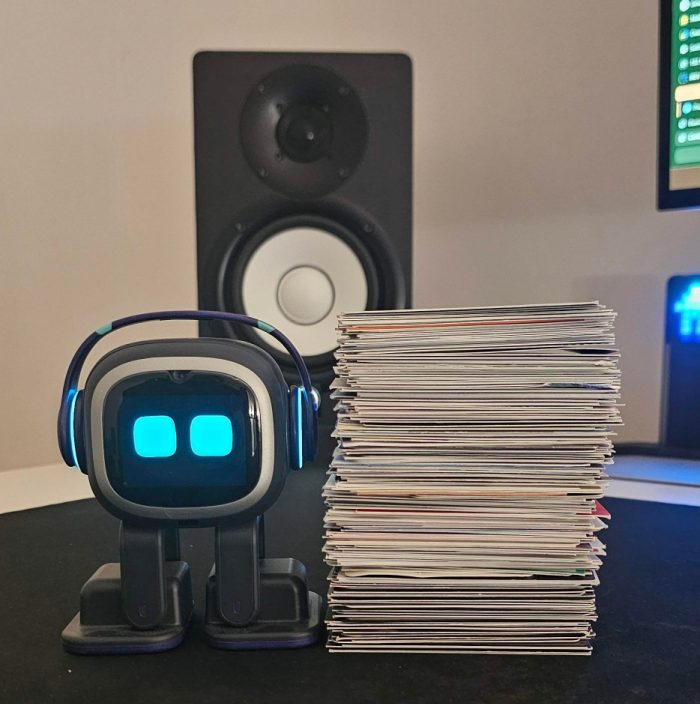
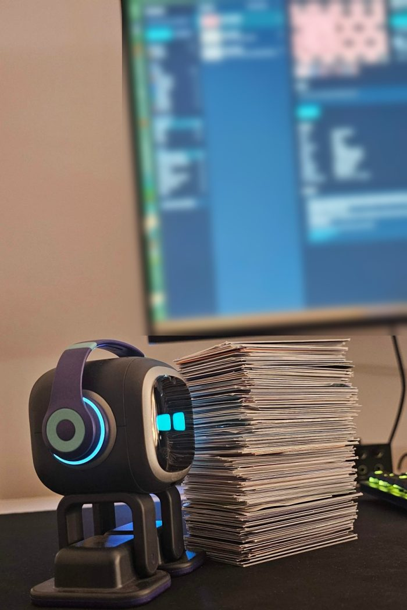
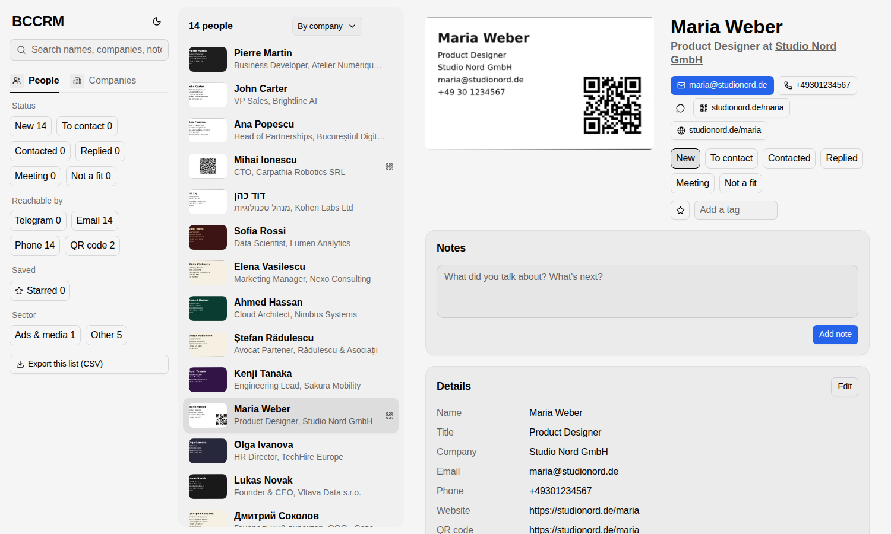

# BCCRM: business cards to a contact CRM

<p align="center">
  
  &nbsp;
  
</p>
<p align="center"><em>200+ business cards from a year of conferences, digitized: every person searchable, every card one click from email or Telegram.</em></p>

<picture>
  <source media="(prefers-color-scheme: dark)" srcset="docs/img/app-dark.png">
  
</picture>
<p align="center"><sub>The contact book, shown here with demo cards.</sub></p>

Photograph your pile of business cards. BCCRM turns the photos into a searchable contact book with:

- the card image beside each person;
- one-click email, Telegram, phone, WhatsApp and LinkedIn;
- QR codes followed to whatever they link to;
- companies grouped and described from the web;
- your own statuses, tags and notes.

```
python run.py      # photos/ -> cards.db (crop, read, check, group, enrich)
python crm.py      # the contact book at http://localhost:8770
```

Both are plain Python with a SQLite file. There's no account, cloud service or framework. Your cards stay on your machine;
only the card crops and web lookups go to the model provider you configure.

## Quick start

```
git clone https://github.com/muninnravenbot-ux/bccrm && cd bccrm
python3 -m venv .venv && .venv/bin/pip install -r requirements.txt
export BC_API_KEY=...            # see Configuration
mkdir photos && cp ~/Pictures/cards/*.jpg photos/
.venv/bin/python run.py
.venv/bin/python crm.py          # open http://localhost:8770
```

Add more photos at any time and run `run.py` again. It only processes new photos, retries anything that failed, and
never overwrites or deletes a card.

## Taking the photos

- **Use the original files from your phone.** Chat apps (WhatsApp, Telegram photos) compress images to ~1280 px and
  the model starts misreading digits. Sending "as file" is fine.
- **Light cards on a dark surface, dark cards on a white sheet**, with gaps between them, in even light without strong
  shadows. 8–20 cards per photo works. Fill the frame with cards rather than your desk.
- **Overview plus close-ups is best.** Cards cut off by the photo edge are skipped, and copies of the same card are
  merged into one person.
- **A single card held in the hand** works too: when no card edges are found, the whole photo is read as one card.

## What `run.py` does

1. **Crop.** OpenCV finds each card using brightness in both directions plus a "mat flood" pass: the background is
   the largest region not crossed by an edge, and anything else is a card. That catches dark and coloured cards on
   dark mats. Overlapping detections are merged. Fragments, sheets, edge-cut cards and size outliers (a keyboard) are
   dropped. Each card is perspective-corrected to `cards/card_0001.jpg`, and every photo gets
   `debug/<photo>_debug.jpg` with numbered boxes, so you can spot misses.
   **Turn upright.** Each crop is shown to the vision model as a 2×2 grid of its four rotations, and the model picks
   the one where the name reads normally. It votes twice with the tiles in different orders, adding a third vote on a
   tie, and the crop is rotated to match. Vertical cards stay vertical; sideways and upside-down cards are fixed.
   Only the crop files change, and your photos in `photos/` are never touched. This runs before the card is read,
   so the model also reads upright text.
2. **QR.** `zxing-cpp` reads the QR codes, with OpenCV as the fallback. On real cards zxing decoded about twice as
   many: coloured codes and codes with a logo in the middle.
3. **Extract.** A vision model reads each card to JSON:
   - name, title, company, emails, phones (E.164), Telegram, website, address, LinkedIn, notes and language;
   - whether it's the back of a card, plus a confidence score.

   Original spelling and script are kept. Skype IDs are dropped. When no website is printed, it's taken from the
   company email domain (not from gmail-style addresses). QR payloads are merged in: `t.me` links become Telegram,
   vCards fill name/email/phone, and other links become the website.
4. **Follow links.**
   - **QR pages:** every QR link is opened, and a text model pulls contact details from the page. Those only fill
     gaps; printed data is never overwritten. A QR-only card back can become a full contact this way.
   - **Telegram handles:** each handle is checked on its public `t.me` page, recording the display name and whether
     it's a person or a channel. Some real accounts hide that preview, so a missing one is never treated as wrong.
5. **Duplicates.**
   - **Same card:** a card is a copy of an earlier one when they share an email, a phone, a Telegram handle,
     name+company or name+title.
   - **Backs:** a logo-only back attaches to the front with the same company.
   - Duplicates are linked, never deleted.
6. **Companies.** People are grouped by company domain: domains that appear on the same card (email + website) and
   the company name count as one company, while link-in-bio hosts never do. Each company with a domain gets two web
   searches, and a text model summarises who they are, what they do, sector, HQ and socials. Only URLs that appear in
   the search results are kept.
7. **Export.**
   - `export/cards.csv`, `export/companies.csv` and `export/needs_review.csv`;
   - `export/review.html` for a quick static look;
   - and the summary line, printed at the end of the run.

Everything is stored in `cards.db` (SQLite): tables `cards`, `photos` and `companies`, plus the CRM's own `crm` and
`notes` tables, which `run.py` never touches.

## The contact book (`crm.py`)

The interface is built with [OpenUI](https://www.openui.com)'s React component library (`@openuidev/react-ui`):
chips, tabs, cards, buttons, inputs, its image gallery and photo viewer, and its light and dark themes. It lives in
`web/`, and the built app in `web/dist/` is committed, so **running it needs only Python**. To change the
interface:

```
cd web && npm install && npm run dev      # live reload against a running crm.py
npm run build                             # writes web/dist, which crm.py serves
```

Without `web/dist`, `crm.py` falls back to `crm.html`, a dependency-free single page with the same features.

- **One entry per person.** All photos of their card and its back sit in a photo strip.
- **Search everything:** names, companies, emails, phones, Telegram handles and display names, QR links, tags,
  notes. Press `/` to search and ↑ ↓ to move.
- **Filters:** status (New, To contact, Contacted, Replied, Meeting, Not a fit), starred, tags, reachable by
  (Telegram, email, phone, QR code), and sector.
- **One-click actions:** email, Telegram, phone, WhatsApp, LinkedIn, websites, and QR links (showing where they
  redirect). A vCard QR can be saved as `.vcf`.
- **Your own data:** notes, tags, a star and a status. Inline edits to any field count as verified data.
- **A Companies view,** with the web profile and everyone you met there.
- **"Export this list (CSV)"** exports exactly what the current filters show.

The server listens on 127.0.0.1 only. It serves the page and card images, never the database or your original
photos.

To keep it running in the background on Linux/WSL, create a systemd user service
(`~/.config/systemd/user/bccrm.service`):

```
[Service]
WorkingDirectory=%h/bccrm
ExecStart=%h/bccrm/.venv/bin/python %h/bccrm/crm.py
Restart=on-failure
[Install]
WantedBy=default.target
```

Then run `systemctl --user enable --now bccrm`.

## Configuration

| Variable | Default | Purpose |
|---|---|---|
| `BC_API_KEY` (or `ZAI_API_KEY`) | none | API key for the chat endpoint |
| `BC_CHAT_URL` | Z.AI Coding Plan endpoint | any OpenAI-compatible `/chat/completions` URL |
| `BC_VISION_MODEL` | `glm-5.3-flash` | reads the card images |
| `BC_TEXT_MODEL` | `glm-5.3` | reads QR pages and web results |
| `BC_SEARCH_MCP` | Z.AI `web_search_prime` MCP | web search for company profiles; set it to empty to skip |
| `BC_FALLBACK_CHAT_URL`, `BC_FALLBACK_API_KEY` | none | a second OpenAI-compatible endpoint for the fallback model |
| `BC_FALLBACK_MODEL` | `claude-sonnet-5-5` | the fallback model |
| `BC_FALLBACK` | on | set to `off` to never use a fallback |
| `BC_PORT` | `8770` | port of the contact book |

**The fallback model** takes over where the main model fails on real cards: when its content filter refuses a card
(Z.AI refused some gambling-industry cards), and for right-to-left scripts (`glm-5.3-flash` reversed Hebrew names).
If `BC_FALLBACK_CHAT_URL` is set it uses that endpoint; otherwise it uses the
[Claude Code](https://claude.com/claude-code) CLI when it's installed and logged in (`claude -p`, with the image read
by its Read tool). With no fallback available, a refused card is kept and flagged for you to fill in.

**Z.AI Coding Plan:** keep the `/api/coding/` endpoint. The general `/api/paas/v4/` endpoint bills your API balance
instead of the plan. For another provider, point `BC_CHAT_URL` at its OpenAI-compatible endpoint and choose a vision
model. The image is sent as a `data:` URL, and JSON mode (`response_format: json_object`) is requested.

## Accuracy

These numbers come from one real batch: 118 photos, 521 card crops, 220 unique cards, 196 companies. Every card was
checked against its image by hand afterwards.

- **Resolution matters most.** The same cards via WhatsApp compression (934×2000) came back with wrong digits and
  invented emails, and gave different answers on repeat runs. The phone originals (1868×4000) read correctly.
- **Model errors.** At full resolution `glm-5.3-flash` was fully right on roughly 3 of 4 cards. The common errors:
  - Skype IDs filed as Telegram;
  - a dropped or extra digit in a phone number;
  - an email domain one letter off.

  `needs_review` flags low-confidence cards. Plan on a review pass: the contact book makes it quick.
- **Cropping limits.** The cropper misses black cards with rounded corners on a black mat, and it struggles with
  dark cards on a mat with strong shadows. Check `debug/` and reshoot those on white.
- **Model limits.** `glm-5.3-flash` garbles right-to-left scripts (Hebrew); use a stronger vision model if you have
  many such cards. Glare on metal cards hides text.

## Failures it handles for you

Every item below happened on a real stack of ~500 cards and is now handled in the code:

| What went wrong | What BCCRM does |
|---|---|
| Chat apps compress photos, so digits and emails get misread | warns per photo when it's under 2400 px; tells you to use the original file |
| Dark cards on a dark mat, light cards on the same mat | several detection passes, including "mat flood", merged |
| Cards cut off by the photo edge become half-card rows | edge-cut boxes are dropped when the photo has other cards |
| A keyboard or legs detected as cards | boxes far bigger than the photo's typical card are dropped |
| A card held in the hand, no mat | no card found means the whole photo is read as one card |
| Cards sideways or upside down | turned upright before reading; two votes plus a tie-break |
| Browser keeps showing the old, unrotated image | image URLs carry a version stamp, so a changed crop is a new URL |
| Coloured QR codes, or a logo in the middle, unreadable | `zxing-cpp` reads them (about twice as many as OpenCV) |
| QR-only cards with no printed contact data | the QR's vCard and links fill the fields; QR pages are opened and read |
| Skype IDs filed as Telegram or left in notes | Skype is dropped in the prompt and again in code |
| Telegram handles that may not exist | checked on `t.me`; a hidden preview is "unconfirmed", not "wrong" |
| Two photos of the same card read differently | the card is flagged for review ("photos disagree") |
| Same person on cards with only a Telegram handle or a name and title | those count as duplicate keys too |
| Logo-only backs | linked to the front with the same company |
| Name-only company searched on the web ("MLB" → baseball) | only companies with a domain are looked up |
| Link-in-bio hosts (linktr.ee, mssg.me) mistaken for the company | never used as a company key |
| Model provider refuses a card (content filter) | the fallback model reads and orients it; with no fallback the card is kept and flagged |
| Right-to-left cards (Hebrew, Arabic) read reversed | re-read with the fallback model |
| Cards with no text (logo or QR backs) stall orientation | an empty answer is "no vote"; the card is left as photographed |
| Dark mode: native menus white on white, dim grey text | themed controls everywhere; text meets WCAG contrast (4.5:1) in both themes |
| Two runs at once, e.g. two chat messages | a lock serialises them (Linux, macOS, Windows) |

## Feeding it from a chat bot

`run.py` reads whatever is in `photos/`, and it's safe to run concurrently (a lock serialises runs). A Telegram or
WhatsApp bot can therefore copy each incoming card photo into `photos/` with a unique name, run `run.py`, and reply
with the summary line it prints at the end.

## License

MIT
